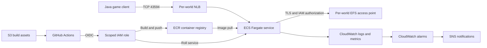
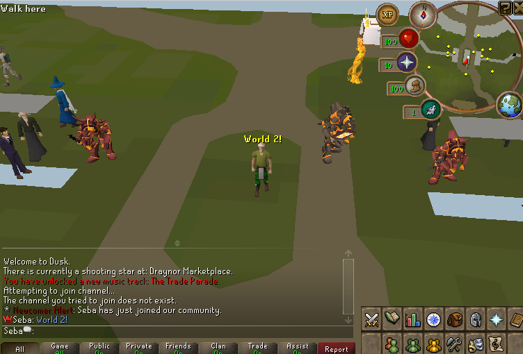
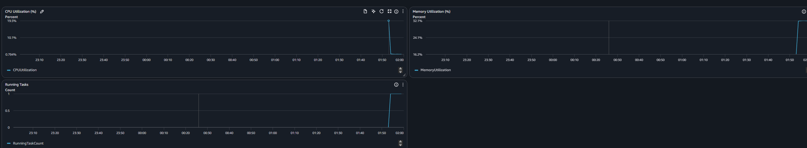
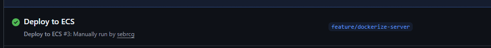

# AWS Runescape Project

**Containerizing a legacy Java application, separating durable state from disposable compute, and operating it with infrastructure as code.**

Cloud and DevOps project by [sebrcg](https://github.com/sebrcg) · [Portfolio](https://seba.sh)

I migrated an existing Java RuneScape game server from a desktop-style deployment to AWS ECS Fargate, then extended it into independent game worlds with persistent storage, stable network endpoints, keyless deployments, and tested monitoring.

This repository presents my infrastructure, automation, and operational work. The original application is maintained in a separate private collaborative repository; its full source, game assets, player data, and Git history are excluded from this public showcase.

## What I built

| Capability | Implementation and outcome |
| --- | --- |
| Container migration | Multi-stage Docker build and ECR image publishing; the Java application runs on ECS Fargate without managing an EC2 host. |
| Repeatable game worlds | A reusable Terraform module creates each world's ECS service, task definition, log group, EFS access point, and Network Load Balancer. Adding a world is one map entry. |
| Durable, separate player data | Encrypted EFS with TLS, IAM authorization, and a separate access point directory per world. Player saves survive task replacement. |
| Stable TCP endpoints | Per-world NLBs route the game's binary TCP protocol to task IPs that ECS registers and deregisters automatically. |
| Keyless CI/CD | GitHub Actions authenticates through OIDC, retrieves build assets from S3, pushes SHA-tagged images to ECR, and rolls a selected ECS service. |
| Tested monitoring | Terraform defines CloudWatch dashboards, CPU/task-count/error alarms, and SNS notifications. Live scale-down and recovery tests verified the notification path. |
| Application troubleshooting | JVM thread dumps and CloudWatch logs exposed startup hangs, failed initialization chains, and faulty health checks that caused repeated task replacement. |

## Architecture

The shared VPC, cluster, registry, IAM roles, and EFS filesystem are separate Terraform stacks. The world module receives their IDs and creates resources for each configured world.

## Read the engineering story

1. **[Migrating the server to ECS Fargate](blog/README.md)** — Docker, networking, EFS persistence, and the Java startup bugs that only appeared in fresh containers.
2. **[Independent worlds and stable endpoints](blog/worlds.md)** — one image, a reusable Terraform module, isolated saves, and Network Load Balancers.
3. **[Observability as code](blog/observability.md)** — dashboards, alarms, SNS notifications, and an end-to-end outage/recovery test.
4. **[Keyless deployment automation](blog/cicd.md)** — replacing six manual deployment steps with a GitHub Actions workflow and short-lived AWS credentials.

The posts document successive lab milestones. Screenshots record those sessions; they do not imply the AWS services are continuously running today.

## Evidence from the lab

### A client connected to World 2

### CloudWatch reports the service running

### The deployment workflow completed successfully

## Inspect the implementation

- [Terraform stacks and dependency guide](infrastructure/README.md)
- [Reusable world module](infrastructure/modules/world/main.tf)
- [Encrypted EFS and task-role authorization](infrastructure/efs/)
- [CloudWatch alarms](infrastructure/observability/alarms.tf)
- [GitHub OIDC role and scoped deployment policy](infrastructure/github-oidc/)
- [Container and CI reference examples](examples/README.md)
- [Pulumi Python baseline](infrastructure-pulumi/README.md) — an earlier implementation of the initial single-server stack, with an S3 remote-state backend and CI preview example. Later Terraform additions are not claimed as Pulumi feature parity.

## Repository scope

This is a public technical showcase, not a complete game distribution. The Dockerfile and deployment workflow require the private application's Gradle project, source, and game assets. They live under `examples/` so this repository does not trigger AWS deployment jobs.

Export adaptations remove account-bound values and stack encryption metadata, use zero-task defaults, and correct the Pulumi zero-value fallback and dependency-free TCP health probe. No AWS resources or IAM trust policies were changed while preparing this repository.

Fargate compute can be stopped by scaling tasks to zero. NLBs, storage, monitoring, and optional database resources can still incur charges; the posts' dollar figures are historical lab estimates. This learning architecture also leaves task ingress restriction to the NLB and image digest pinning as future work.
