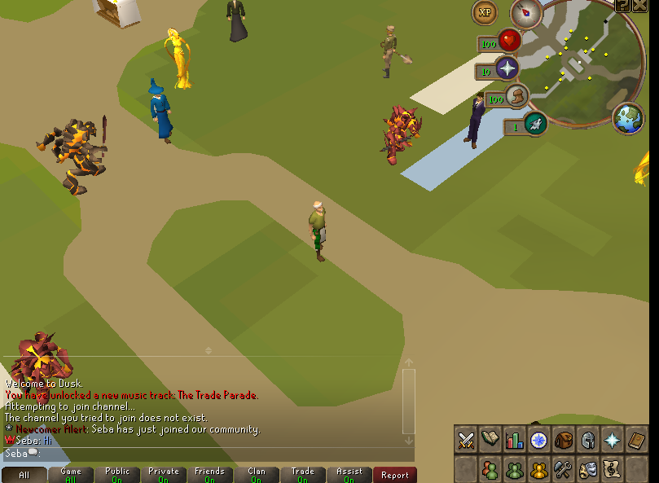
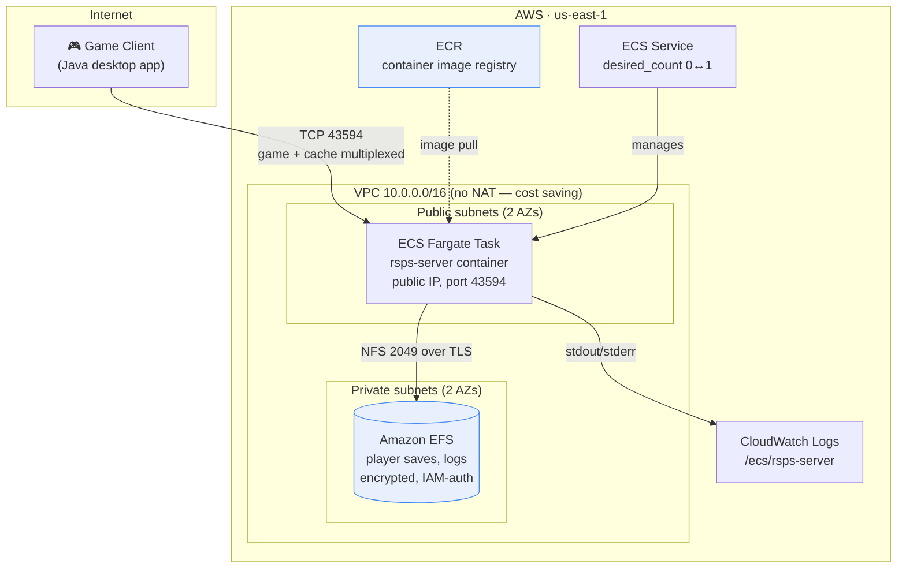
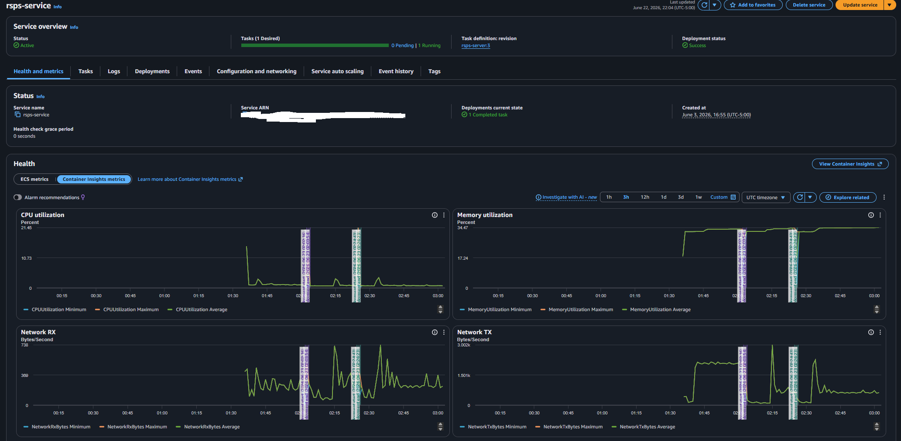
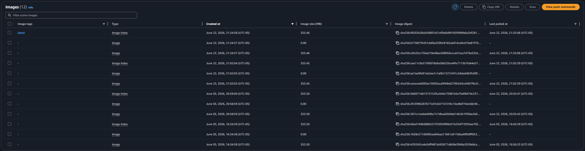
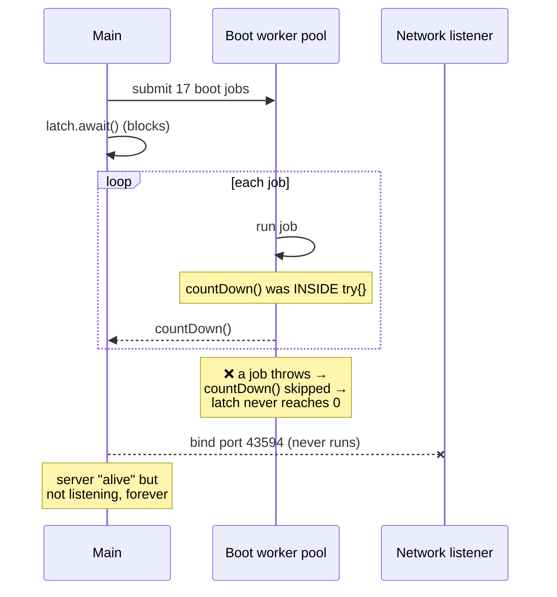
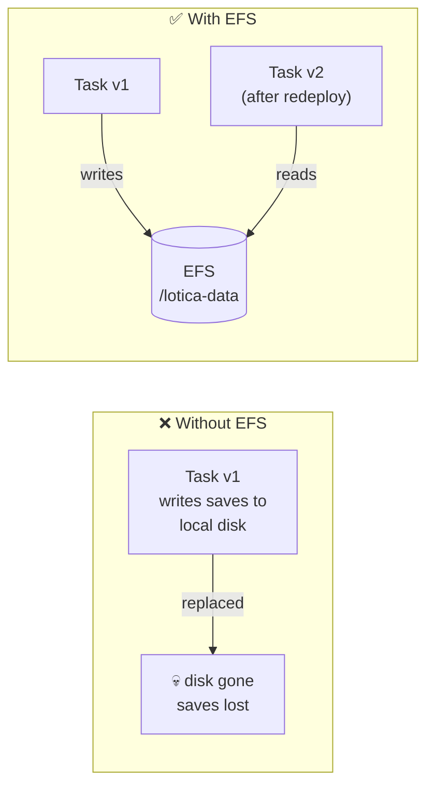
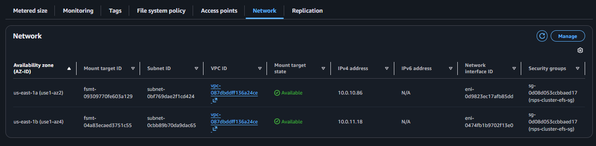
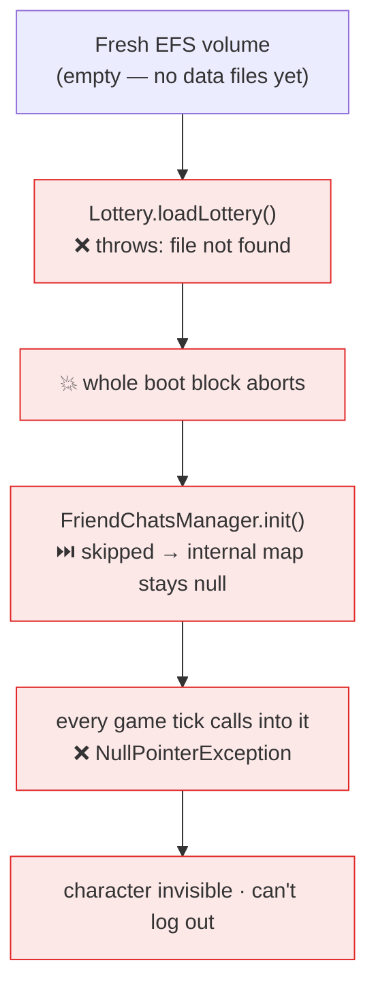
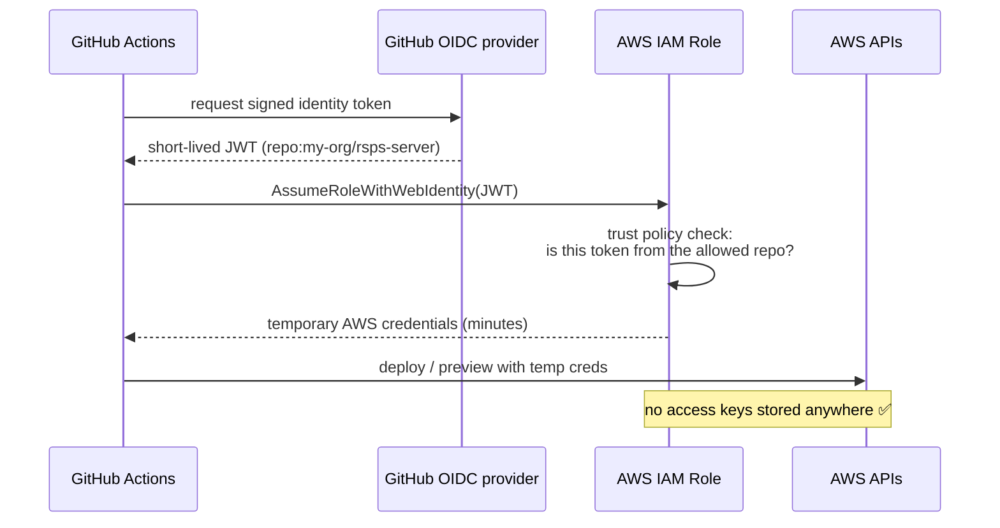

# Putting a 2006-era Game Server on AWS ECS Fargate

> Part of a documented learning lab. Costs are historical estimates from these sessions; later posts describe the additions to the initial architecture.
> [Project overview](../README.md) · [Part 1](README.md) · [Part 2](worlds.md) · [Part 3](observability.md) · [Part 4](cicd.md)


> How I took a legacy Java RuneScape private server, containerized it, and ran it on
> serverless infrastructure on AWS — and the bugs I had to fight along the way.

*A learning project documenting my path toward a cloud / DevOps role. Every step below
is a real thing I built, broke, and fixed.*

---

## TL;DR

I took an old, single-binary Java game server that was only ever meant to run on
someone's desktop, and I:

- **Containerized it** with a multi-stage Docker build (Gradle build → runtime stage).
- **Deployed it to AWS ECS Fargate** — no servers to patch, billed only while running.
- Wired up **all the supporting infrastructure as code** with Terraform: VPC, ECR,
  IAM, CloudWatch Logs, a task definition, and a service.
- Added **persistent storage with Amazon EFS** so player saves survive a container
  being thrown away and replaced.
- Set up **keyless CI** using GitHub OIDC — no long-lived AWS keys stored in GitHub.
- Designed the project around an **on-demand cost model**: scale to zero when I'm not
  playing, pay ~$1.2/day only when I am.

The interesting part isn't the happy path — it's the handful of bugs that only show
up when a desktop app meets a cloud platform. Those are below.


*Logged in and standing in-game — the client on my desktop talking to the server running
on AWS Fargate, with the character saved to Amazon EFS.*

---

## The architecture

Everything is defined as code. Each box below is a Terraform stack or an AWS resource
I provisioned.



**Why these choices:**

| Decision | Reason |
|---|---|
| **Fargate** (not EC2) | No OS to patch, no capacity to manage. For a single game server, the operational simplicity beats the small price premium. |
| **No NAT Gateway** | A NAT gateway is ~$32/month *just sitting there*. The task lives in a public subnet with a public IP instead, saving that cost on a hobby project. |
| **EFS** (not EBS) | Fargate tasks are ephemeral and can be replaced at any moment, landing on a different host. EFS is a network file system any task can mount — perfect for "the container is disposable but the data is not." |
| **`desired_count` 0↔1** | The infrastructure (registry, VPC, IAM, EFS-at-rest) is effectively free when idle. I only pay for compute when a task is actually running, so I scale to zero between play sessions. |
| **OIDC for CI** | No AWS access keys stored as GitHub secrets. GitHub mints a short-lived token that AWS trusts for *this repo only*. |


*The live ECS service on Fargate — one healthy task, with CPU, memory and network
throughput flowing. Scaled back to zero the moment I'm done to stop the meter.*

---

## The build: turning a desktop app into a container

The server is a Java 8 app built with Gradle. The Dockerfile is multi-stage:

1. **Build stage** — `eclipse-temurin:8-jdk`, runs Gradle to compile the application and produce its distribution.
2. **Runtime stage** — a separate `eclipse-temurin:8-jdk` stage receives the build output and static game cache/resources. The exported Dockerfile still uses a JDK in both stages; a smaller runtime image is a possible later optimization.

The image came out around **1.12 GB** (game caches are large) and was pushed to **ECR**.

> 🐛 **Gotcha #1 — the silent 403 push.**
> My first `docker push` failed with a `403` partway through the upload, because the
> ECR auth token had gone stale mid-upload. Worse: I'd piped the command through
> `tail`, so the shell reported the exit code of `tail` (success) instead of the
> failed `push`. **Lesson: when you pipe a command, `$?` is the *last* command's exit
> code, not the one you care about.** A fresh `aws ecr get-login-password | docker
> login` fixed it.


*The built image in Amazon ECR — tagged, digested, and ready for Fargate to pull.*

---

## Bug hunt: when a desktop app meets a cloud platform

This is the part I'm proudest of, because none of these show up on a developer's
laptop. They only appear once a scheduler is allowed to kill and restart your process.

### 🐛 Gotcha #2 — the health check that killed the server every 2.5 minutes

My first ECS health check ran `netstat -an | grep 43594` to see if the game port was
listening. Problem: **the runtime image doesn't ship `netstat` or `ss`.** The command
errored, ECS marked the task unhealthy, killed it, started a new one... which also
"failed" the same check, in an endless loop. Every new task got a **new public IP**, so
the server was never reachable for long.

The fix uses bash's built-in `/dev/tcp` pseudo-device — no extra binaries needed:

```hcl
healthCheck = {
  command     = ["CMD-SHELL", "bash -c 'exec 3<>/dev/tcp/127.0.0.1/43594' || exit 1"]
  interval    = 30
  timeout     = 5
  retries     = 3
  startPeriod = 120   # give the JVM time to boot before probing
}
```

### 🐛 Gotcha #3 — the server that booted but never listened

After fixing the health check, the task would go "healthy" but *still* refuse
connections sometimes. This one was subtle.

The server boots by submitting **17 startup jobs** to a worker pool, then blocking on a
`CountDownLatch` until all 17 finish — and **only then** does it bind the network port.



Two of the boot jobs **threw exceptions** because they tried to read data files
(`punishments.json`, a lottery file) that don't exist in a fresh container — those
files are runtime data, deliberately not baked into the image. Because the
`countDown()` call sat *inside* the `try` block, a thrown job skipped its countdown,
the latch never hit zero, `await()` blocked forever, and the port was never bound.

**The fix is a one-liner that's also a classic concurrency lesson:** move the
`countDown()` into a `finally` block so it *always* runs, even when the job fails.

```java
try {
    work.getTask().run();
} finally {
    workLoad.remove(work);
    countDownLatch.countDown();   // <-- always decrement, even on exception
}
```

I confirmed the diagnosis by running the container locally and taking a `jstack` thread
dump — the main thread was parked at `await()`, with no thread still running the failed
jobs. (The missing-data-files problem is what EFS later solves properly.)

### 🐛 Gotcha #4 — the public IP that moves every time

Every time a Fargate task is replaced — a deploy, a health-check failure, AWS
maintenance — it gets a **brand-new ENI and a brand-new public IP**. I burned real time
testing against a stale IP that no longer pointed at anything.

This is *the* classic ephemeral-infrastructure lesson: **a task is cattle, not a pet,
and so is its IP address.** The proper fix is a load balancer with a stable DNS name in
front (on my roadmap below). Until then, every play session starts with "grab the new
IP."

### 🐛 Gotcha #5 — the local impostor

The single most humbling bug. I'd connect my game client to "the cloud server," log in,
and see *"your account is already logged in"* — which felt like a great sign that the
cloud server was working.

It wasn't. There was a **leftover local Docker container from months earlier** still
listening on `127.0.0.1:43594`. My client was talking to *that*, not to AWS. The cloud
logs showed **zero** logins. `docker ps` + a port check exposed the impostor.

**Lesson: before you test a remote endpoint, make sure nothing local is squatting on
the same port and quietly answering for it.**

---

## Persistence: stateful data on stateless containers

A game server is useless if every restart wipes everyone's character. But Fargate tasks
have *no durable local disk*. The answer is **Amazon EFS** — a network file system the
container mounts at the exact path the game writes its data to.



The neat part: the server's original author had **already designed for this**. A quick
read of the code showed that when it detects a Linux host, it points all its dynamic
data at `/opt/lotica/data`. So I mounted EFS at exactly that path and needed **zero code
changes** — the saves just started landing on durable storage.

The EFS setup is locked down:

- **Encrypted at rest**, and **TLS in transit** for the NFS traffic.
- **IAM authorization** — only a task wearing the correct task role can mount it.
- An **access point** sandboxes the container to one directory.
- A dedicated **security group** allows NFS (port 2049) *only* from the task's security
  group — nothing else in the VPC can reach it.
- **A mount target in each Availability Zone**, each on a private subnet, so a task can
  attach the file system no matter which AZ it lands in.


*The EFS Network tab: two mount targets, one in each Availability Zone's private subnet,
each locked to the dedicated `rsps-cluster-efs-sg` security group and reachable only over
private NFS inside the VPC. This is what lets a task in either AZ reach the same durable
file system.*

---

## The bug that empty storage caused: a boot-time cascade

Here's a bug I'm glad I hit, because it taught me more than the happy path ever could.

When I first logged into the server running on EFS, my character was **invisible and
frozen** — I could connect, but I couldn't see myself or even log out. The client said my
account was *"already logged in."* The cloud logs told the real story: my login was
reaching the server, then **crashing with a NullPointerException** every single game tick.

I traced it back through three layers, and the root cause was beautiful in a depressing
way. The server boots by running a list of initializers. Several of them are **grouped
together in one block**, like this:

```java
() -> {
    Lottery.loadLottery();              // reads a data file that doesn't exist yet on fresh EFS
    CutscenesHandler.init();
    FriendChatsManager.init();          // ← never runs
    ClansManager.init();
    RandomEventManager.populateQuestionBank();
}
```

On a brand-new EFS volume, those data files don't exist yet. `Lottery.loadLottery()`
throws — and because all five calls share one block with no isolation, **the exception
aborts the whole block.** Everything after it silently never runs. So
`FriendChatsManager.init()` never executed, which left an internal map `null`, which then
threw an NPE on every game tick when my character tried to render. One missing optional
file took down a completely unrelated system three steps away.



**The fix** is the same lesson as a classic boot bug I'd already hit earlier in this
project (a latch that never counted down because a failure skipped its `countDown()`):
**isolate failures so one missing optional thing can't take down everything around it.**
I wrapped each initializer so a failure is logged and skipped instead of cascading:

```java
for (initializer : initializers) {
    try {
        initializer.run();
    } catch (Throwable t) {
        log("step '" + name + "' failed; continuing without it: " + t);
    }
}
```

After redeploying, the boot logs showed exactly what I wanted — the lottery loader still
fails (its file genuinely isn't there yet), but now it fails **alone**:

```
[Boot] step 'Lottery.loadLottery' failed; continuing without it: File doesn't exist...
Game Server prepared in 7022 milliseconds.
```

…and I logged in clean. The screenshot at the top of this post is that exact session.

**Why this is a cloud lesson, not just a Java one:** this bug was invisible on a
developer's laptop, because a laptop always has those data files sitting on disk. It only
appeared when the app met **fresh, empty network storage** — which is exactly what a
stateful container gets the first time it boots. *Disposable compute on durable storage*
means the storage starts empty, and your boot path has to survive that.

---

## Keyless CI with GitHub OIDC

Storing long-lived AWS access keys in GitHub Actions secrets is a liability — if they
leak, an attacker has standing access. Instead I used **OpenID Connect**: GitHub mints a
short-lived token for a workflow run, and an IAM role trusts that token **only when it
comes from this specific repository**.



The IAM role has a **least-privilege** policy (read-only describes plus write access to
just the one state bucket) and a trust policy scoped to `repo:<my-org>/rsps-server:*`.

> 🐛 **Gotcha #6 — "incorrect passphrase" that was really "empty secret."**
> The CI pipeline failed with a misleading *"incorrect passphrase"* error. The real
> cause: I'd added a required value as a GitHub **Variable** instead of a **Secret**, so
> the workflow's `${{ secrets.X }}` resolved to empty. An *empty* secret and a *wrong*
> secret produce different errors — knowing the difference saved a lot of guessing.

---

## The cost model

This is a hobby project, so cost discipline mattered and was good practice.

| Resource | Cost when idle | Cost when running |
|---|---|---|
| ECR image storage | ~free (a few cents) | same |
| VPC, IAM, security groups | $0 | $0 |
| EFS (data at rest) | a few cents/GB-month | same |
| **Fargate task (compute)** | **$0** (scaled to zero) | **~$1.2/day** |
| NAT Gateway | *removed* (would be ~$32/mo) | — |

Scaling `desired_count` to `0` between sessions means the only meaningful charge is
compute, and only while I'm actually playing. One early lesson the hard way: I left the
server running unattended for ~4 days once and quietly accrued ~$5. **Now "stop the
service" is the last step of every session.**

---

## Roadmap at the end of Part 1

This project is deliberately built in resume-sized increments. Done so far:
**containerize → deploy → OIDC → EFS persistence.** At this stage, the following were still ahead. [Part 2](worlds.md) completes the NLB work, [Part 3](observability.md) adds monitoring, and [Part 4](cicd.md) documents the deployment pipeline:

1. **NLB + Route 53 DNS** — a stable address so the IP stops moving every restart
   (fixes Gotcha #4 properly).
2. **Security scanning in CI** — `tfsec`/`checkov` for the Terraform, image scanning for
   the container.
3. **CI/CD deploy pipeline** — push to main → build, scan, deploy automatically.
4. **Observability** — dashboards and alarms on the CloudWatch logs/metrics.

---

## What this project taught me

- **Cloud bugs hide in the gaps** between "works on my laptop" and "a scheduler can kill
  me at any time" — health checks, ephemeral IPs, latches that never count down.
- **Read the error literally.** "Incorrect passphrase" vs. "must be set"; `tail`'s exit
  code vs. `push`'s. The platform usually *is* telling you the truth.
- **Disposable compute, durable data.** Designing for the task to vanish at any moment
  is the whole mindset shift, and EFS is how you keep the data.
- **Infrastructure as code makes it real.** Every box in that first diagram is a
  Terraform resource I can destroy and recreate on demand.

---

Explore the [Terraform stacks](../infrastructure/README.md), [Dockerfile example](../examples/container/Dockerfile), and [deployment workflow](../examples/ci/deploy.yml.example).
