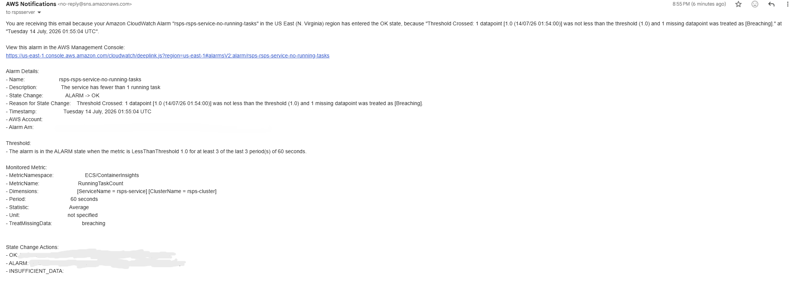

# Knowing When It Breaks: Observability as Code

> Part of a documented learning lab. Costs are historical estimates from these sessions; later posts describe the additions to the initial architecture.
> [Project overview](../README.md) · [Part 1](README.md) · [Part 2](worlds.md) · [Part 3](observability.md) · [Part 4](cicd.md)


*Part 3 of putting a legacy Java RuneScape server on AWS. [Part 1](./README.md) got it onto Fargate; [Part 2](./worlds.md) made it multi world. This post is the other half of running something in production: not shipping it, but **knowing whether it is alive** and getting told the moment it is not.*

## TL;DR

1. Built a CloudWatch **dashboard, alarms, and email alerting** for the server, entirely in **Terraform**, so my monitoring is version controlled rather than clicked together in a console.
2. **Proved it live:** I took the service down on purpose and watched the alarm fire. I brought it back and watched the alarm clear and land a recovery email in my inbox.

## The gap: I can *deploy* it. Can I tell if it is *alive*?

By the end of Part 2 I could deploy the server, run many worlds, and, with the CI/CD pipeline, ship a new version with one click. But none of that answers the question that matters at 3am: **is it actually healthy right now, and will something tell me if it is not?**

That is observability. You cannot operate what you cannot see.

## What I built, all as code

A new Terraform stack (`infrastructure/observability/`) with three layers:

1. A **dashboard** with CPU %, memory %, and running task count on one screen.
2. **Alarms** for high CPU, **zero running tasks**, which is the "it is down" alarm, and a **log based** alarm that fires on `ERROR` lines.
3. **Notifications** using an **SNS topic and email subscription**, so an alarm actually *pages me*.

The flow is simple and worth memorising:

```text
Metric, such as RunningTaskCount → Alarm with threshold and evaluation window → SNS topic → Email in my inbox
```

### The dashboard


*CPU %, memory %, and running tasks for the service. The graphs jump to life the moment a task boots. That spike on the right is the demo below.*

### The alarms and the subtle part

Three alarms, each wired to the SNS topic. The **subtle, interview worthy** bit is `treat_missing_data`, which controls what an alarm does when there is **no data at all**:

1. **"No running tasks"** means missing data is **breaching**. If the service stops reporting, that silence *means* it is down, so I want the alarm to fire.
2. **"High CPU"** means missing data is **not breaching**. No tasks means no CPU metric, and that is fine. I do not want a false alarm just because nothing is running.

The third alarm uses a **log metric filter**. It turns a text pattern, `ERROR`, in the log group into a countable metric, which I then alarm on. Logs become numbers become alerts.

## Proving it: I broke it on purpose

Monitoring you have not tested is a guess. So I ran the whole loop:

1. The service sat at `desired_count = 0`. The **"no running tasks" alarm was in `ALARM`**, correctly, because zero tasks were running.
2. I scaled it to `1`. `RunningTaskCount` climbed **0 → 1**, the dashboard filled with real CPU and memory data, and after the metric held, the alarm flipped **`ALARM → OK`**, with an email:



*The alarm noticing the recovery on its own and emailing me the `ALARM → OK` transition. The full loop is metric → alarm → SNS → inbox.*

### The detection delay lesson

The alarm did **not** clear the instant the task came up. There were two reasons, and both are real:

1. **Metric lag:** CloudWatch takes a few minutes to start reporting a new metric.
2. **Evaluation periods:** The alarm waits for the signal to hold for several periods before changing state, on purpose, so it does not **flap** on a single blip.

So there is a built in delay between "reality changed" and "the alarm agrees." That is not a bug. It is the trade of **stability for speed**, and knowing it exists is the difference between trusting your alarms and second guessing them.

## Cost

About **$0.30 per month** for a few alarms and an SNS topic. Unlike the load balancers, this is cheap enough to leave running.

## Lessons

1. **You cannot operate what you cannot see.** Deploying is half the job; observing is the other.
2. **"No signal" is a signal.** `treat_missing_data` is a real decision for each alarm.
3. **Alarms trade speed for stability.** Evaluation windows prevent flapping at the cost of a detection delay.
4. **Monitoring as code** means it is reproducible, reviewable, and version controlled, following the same discipline as the rest of the infrastructure.
