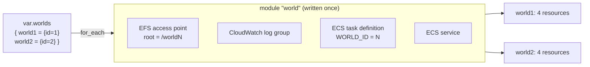
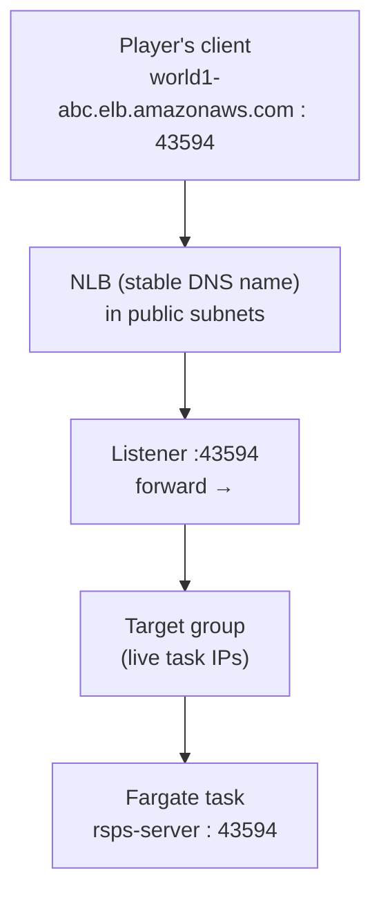
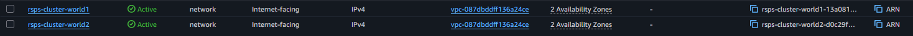

# Going Multi World: One Game Server, Many Worlds on AWS

> Part of a documented learning lab. Costs are historical estimates from these sessions; later posts describe the additions to the initial architecture.
> [Project overview](../README.md) · [Part 1](README.md) · [Part 2](worlds.md) · [Part 3](observability.md) · [Part 4](cicd.md)


*Part 2 of deploying a legacy Java RuneScape server to AWS. [Part 1](README.md) ends with a moving-IP problem. This post gives each world a stable endpoint and isolated player data.*

---

## TL;DR

* Took a single game server and made it run as **N independent worlds**, each with its own saves, economy, and address, from **one Docker image** and **one Terraform module**.
* One env var (`WORLD_ID`) + one Terraform `for_each` = "build once, configure many" at two altitudes.
* Each world gets its own **EFS access point** (AWS enforced storage isolation) and its own **Network Load Balancer** (a stable DNS name that finally kills the moving IP problem from Part 1).
* Adding a world is now a **one line change**.

---

## Why "worlds", and the trap I avoided

In RuneScape a "world" is a separate server you pick from a list (world 301, 302…). I wanted the same: several servers players can choose between.

The dangerous way to do this is to let multiple servers share one set of save files. Player saves here are just flat JSON files on disk. A character *is* a file, and an economy *is* a folder of them. If two worlds share that folder, a player could log into both at once, and the last writer wins save would **duplicate items**, the classic economy killer.

So I chose **fully independent worlds**: each world owns its own save folder and economy. World 1's "seba" and World 2's "seba" are unrelated characters. No shared state means no dupes.

---

## Milestone 1: Making the image world aware

A world only needs to know *which* world it is. That's a single environment variable.

```java
// GameConstants.java
public static final int WORLD_ID = parseWorldId(System.getenv("WORLD_ID"));
```

```java
// Main.java, first line of boot
System.out.println("Starting World #" + GameConstants.WORLD_ID);
```

`parseWorldId` defends against a missing or garbage value by defaulting to `1`. The point of this
change is the principle behind it:

> **Build the image once. Run it many times. Each instance's behavior comes from its environment, not from different code.**

I proved it by running the *same compiled jar* twice. With `WORLD_ID` unset, it printed
`Starting World #1`, and with `WORLD_ID=2`, it printed `Starting World #2`. Same code, one variable, two worlds.


---

## Milestone 2: "A world" as a reusable Terraform module

This section records the original four-resource module. The current [world module](../infrastructure/modules/world/) also includes the NLB, listener, and target group added in Milestone 3.

The infrastructure is the same idea one altitude up. I wrote a `world` **module**, a reusable bundle of resources that describes *everything one world needs*, then stamped it out with `for_each`.



Adding `world3 = { id = 3 }` is a **one line change**. `for_each` builds the other four
resources for it automatically. I watched the plan go from `8 to add` to `12 to add` and back to `8` by editing that single line.

A few Terraform ideas this drove home:

* **`data` vs `resource`**: the shared cluster, VPC, subnets, IAM roles and EFS are read in as read only **data sources**; the module only **creates** the per world resources. That keeps the stack decoupled from the ones that own the shared infrastructure.
* **`for_each` over `count`**: `for_each` keys each world by name (`module.world["world1"]`), so deleting one world touches only that world. `count` indexes by number, so removing a middle one renumbers the rest and recreates the wrong things.
* **Cost safety**: `desired_count = 0` by default, so applying creates all the scaffolding but runs **zero tasks**, avoiding Fargate compute charges. NLBs and storage still have standing costs.


### The dependency graph, seen live

I never tell Terraform the order to build things. It reads the **references** between resources and figures it out. When I ran `apply`, the log proved it:

1. The **log groups and access points** were created first, in parallel, because nothing depends on them.
2. The **task definitions**, because they reference the access point ID.
3. The **services**, because they reference the task definition.

Foundation, frame, door. The order is inferred from the code and executed automatically.

### Storage isolation, enforced by AWS

Each world's **EFS access point** is rooted at its own directory (`/world1`, `/world2`) but
mounted at the *same* `/opt/lotica/data` inside every container. The access point sandboxes a task to its directory, so World 2 physically **cannot** see World 1's files. Isolation is enforced at the storage layer, following least privilege, and the app needs zero per world changes.


---

## Milestone 3: A stable address per world (NLB)

Part 1 ended on a real problem: **every time a Fargate task restarts, it gets a new public IP.** You can't give players a world list of addresses that keep changing. The fix is a **load balancer**, a permanent front door that forwards to whatever task is alive behind it.

**Why a Network Load Balancer, not an Application one?** An ALB is Layer 7. It speaks HTTP and routes by URL. My game speaks a **raw binary TCP protocol**, so there's nothing for an ALB to route on. An **NLB is Layer 4**. It just forwards TCP. Right tool.



The key trick is **how the address stays fixed while tasks are disposable**. The ECS service's `load_balancer` block makes **ECS automatically register and deregister each task's IP in the target group** as tasks start and stop. The NLB just reads that target group, so it always points at a live task. The DNS name never changes.

> The tasks are cattle. They die and respawn with new IPs. The NLB is the one pet: a single stable DNS name. It's disposable compute behind a durable address.

Two details worth calling out:

* **`target_type = "ip"`**: with Fargate there's no EC2 instance to register; each task is its own network interface with an IP, so the target group tracks IPs directly.
* **Two health checks now, two jobs**: the container's own `/dev/tcp` probe tells **ECS**
  "keep or replace this task"; the target group's TCP probe tells the **NLB** "route to it or not." Same port, different deciders.

And because all of this went into the same `world` module, `for_each` gives **every world its own NLB** automatically.



*Two Network Load Balancers, one per world, each with a permanent DNS name. The address never changes, even as the task behind it is replaced.*


*Logged into World 2 through its NLB's stable DNS name. It's a fresh character because World 2 has its own isolated **`/world2`** save directory. Same account, completely separate economy: the per world isolation, proven end to end.*

> At this milestone, I selected worlds by changing the endpoint. Milestone 4 below adds selection through a launch flag; a graphical world-selection screen remains future work.

### The honest cost note

Scaling tasks to zero removed Fargate compute charges; storage and monitoring still had small standing costs. Each NLB adds a standing charge of roughly **$16/month just to exist**, running or not. So the plan is: build it, demo it, screenshot it, then
`terraform destroy` to stop the meter. I keep the code, the knowledge, and the screenshots without an ongoing bill. To see traffic actually flow, I briefly scale one world to a single running task, which costs about $1.2/day for Fargate, just during the demo.

---

## Milestone 4: Picking a world from the client

Two worlds behind two addresses is only useful if the client can *choose* between them. The full featured version would be a RuneScape style world select screen, but my client is a heavily obfuscated legacy build, and rebuilding its interface system would have been a large reverse engineering effort that taught me nothing about the cloud. So I made an engineering call: solve it at the **config layer**, not the UI.

The client now keeps a small map of worlds and picks one **at launch**:

```java
// ClientConstants.java
private static final Map<Integer, String> WORLDS = new LinkedHashMap<>();

static {
    WORLDS.put(1, "world1-nlb-dns.elb.amazonaws.com");
    WORLDS.put(2, "world2-nlb-dns.elb.amazonaws.com");
}

// chosen at launch with -Dworld=N, defaults to 1
public static final int WORLD = parseWorld(System.getProperty("world"));
```

```bash
java -Dworld=2 -jar client.jar   # connect to World 2
```

No flag means World 1. Running locally in dev still means `127.0.0.1`, untouched. Adding a world is one line in the map.

That's the **client half of "build once, configure many"**, the exact mirror of the server's
`WORLD_ID`. One client binary, many worlds, chosen by configuration instead of a recompile. And the real lesson underneath it is this: *pick the scope that serves the goal.* A launch flag delivered the multi world behavior in a handful of lines, where a full UI rebuild would have cost days for zero cloud skills gain. Knowing which corner to cut is part of the job.

## What's next

* A real in client **world select screen** instead of the launch flag. Pure polish, if I
  ever feel like reverse engineering the client UI.
* **Locking each world's task security group to only its NLB**. Right now the task ports are open to the internet; they should only accept traffic from the load balancer.
* **Seeding baseline data** so a fresh world boots with nothing failing, instead of relying on the loaders' fail soft handling.

## Lessons

* The same principle, build once, configure many, showed up twice: an env var in the app, and a `for_each` module in the infrastructure.
* "Disposable compute on durable storage" grew a third leg: **a durable address**, too.
* Isolation is strongest when the platform enforces it through per world access points rather than the app remembering to.
* Not everything scales to zero. An NLB has a floor cost, which is worth knowing *before* you leave one running.
